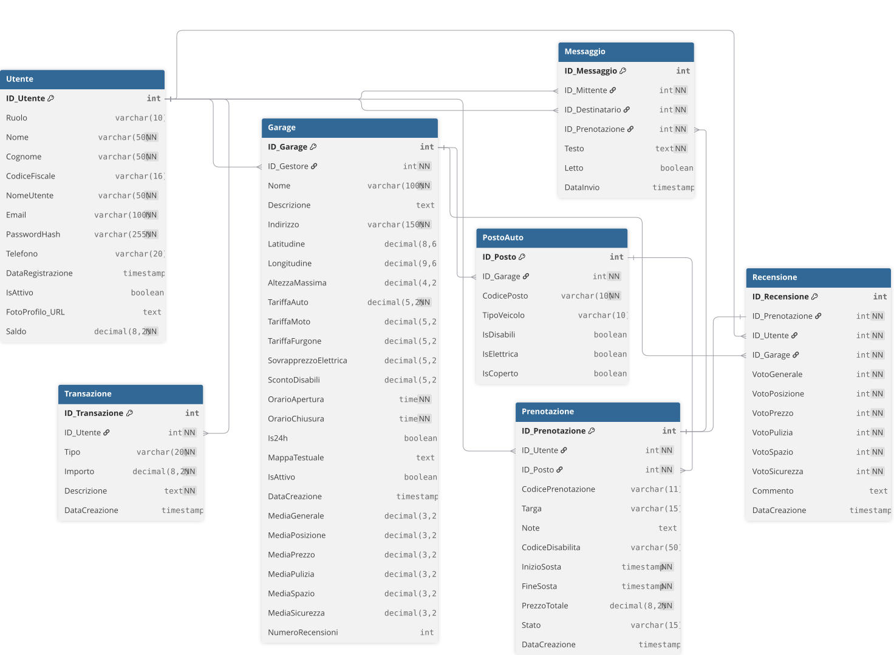

<h1 align="center">
  
</h1>

<p align="center">
  
  
  
  
  
  
  
  
  
</p>

[Italian 🇮🇹](README.it.md)

---

Parkly is a full-stack web application for parking management and reservations, a project developed during the _Web Technologies and Systems_ course at Sapienza University of Rome.

## Table of Contents

- [Architecture and technologies used](#architecture-and-technologies-used)
- [Project structure](#project-structure)
- [Database schema](#database-schema)
- [Features](#features)
  - [Authentication flow](#authentication-flow)
  - [Garage search](#garage-search)
  - [Parking spot reservation](#parking-spot-reservation)
  - [Wallet management](#wallet-management)
  - [The Manager role and publishing a garage](#the-manager-role-and-publishing-a-garage)
  - [Review system](#review-system)
  - [Interactive chat](#interactive-chat)
  - [Parking spot maintenance](#parking-spot-maintenance)
- [Views](#views)
- [Installation](#installation)
  - [Prerequisites](#prerequisites)
  - [Installing dependencies](#installing-dependencies)
  - [Database configuration](#database-configuration)
  - [Environment variables](#environment-variables)
  - [Running the application](#running-the-application)
- [Authors](#authors)
- [License](#license)

## Architecture and technologies used

The project is structured according to a client-server architecture, separating the user interface from the APIs and data management.

The frontend is based on Vue.js and Vite. The user interface is built with Bootstrap, while Leaflet was used for rendering and integrating the geographic map.

The backend is a Node.js server based on Express. For authentication, we used express-session and cookies, protecting passwords with bcrypt.

Regarding data, we chose a relational database, PostgreSQL (hosted via Supabase). In addition to the database, we use the Supabase Storage bucket (interfaced via multer in memory on the server) to manage static files, such as user profile pictures.

Finally, Socket.IO was integrated for real-time chat functionality.

## Project structure

```
parkly/
├── client/
│   └── src/
│       ├── assets/          # Images and icons
│       ├── components/      # Reusable UI components
│       ├── composables/     # Encapsulated reactive logic
│       ├── router/          # Client-side routing
│       ├── store/           # Application state
│       ├── utils/           # Helper functions
│       └── views/           # Views
└── server/
    ├── database/
    │   ├── parkly.sql       # Schema definition
    │   └── seed.sql         # Sample data
    ├── middleware/
    │   └── authMiddleware.js
    ├── routes/              # API endpoints
    └── index.js
```

## Database schema

The database consists of eight tables. `Utente` is the central entity: a user with the `GESTORE` role can own one or more `Garage` entities, each consisting of multiple `PostoAuto` spots. Spots can be temporarily excluded from availability via `ManutenzionePosto`. A `Prenotazione` associates a user with a spot for a defined time interval and serves as the prerequisite for dependent entities: `Messaggio`, `Recensione`, and `Transazione`. Below is the ER diagram:

<p align="center">
  
</p>

## Features

- Parking spot reservations with time slot selection and automatic wallet charging.
- Garage search by geographic location on an interactive map and list, with filters for vehicle type, disabled access, electric charging, and covered parking.
- Integrated wallet with manual top-up and full transaction history.
- Real-time chat between customer and manager, contextualized to active reservations.
- Review system tied to completed reservations.
- Manager dashboard with real-time occupancy, monthly statistics, and an interactive garage floor plan.
- Parking spot maintenance management with automatic exclusion from availability.

### Authentication flow

Authentication is handled via sessions and encrypted passwords. Users can manage their profile, customize their avatar, update personal details, or request the Manager role. The system also supports account deletion via soft-delete to preserve the integrity of historical data.

### Garage search

Search combines geographic positioning and time availability. On the client side, the system calculates the distance between destination and garage, sorting results by proximity. Reactive filters allow users to refine the search by vehicle type and additional amenities such as electric charging, disabled access, and covered parking spots.

On the backend, the system verifies actual spot availability by querying the database using the `OVERLAPS` clause. This time cross-referencing excludes garages that are already occupied during the selected hours, ensuring users only see bookable results.

### Parking spot reservation

The reservation flow guarantees maximum data consistency through atomic transactions. The user selects a spot from the interactive floor plan, and the client formally validates the data by calculating the price quote.

To prevent simultaneous booking conflicts, the server applies a row-level lock on the database. Within the same transaction, the system verifies the balance, charges the cost to the wallet, and generates the ticket.

### Wallet management

Parkly integrates a virtual wallet to simplify payments, allowing top-ups between €5 and €1000. The use of atomic transactions in the backend ensures that updating the balance and recording the transaction in the history occur simultaneously.

Users can view the full history of their activities through a paginated chronological list that explicitly distinguishes between top-ups, payments, and refunds.

### The Manager role and publishing a garage

The dedicated dashboard for managers allows publishing new garages on Parkly through a guided three-step flow.

In the first step, the garage location is defined: starting from an address, the system queries a geocoding API and generates coordinates; to ensure maximum accuracy, the user can manually refine the coordinates by clicking directly on the map.

The second step involves the technical configuration of the parking spots. The manager defines each parking spot by specifying the vehicle type and included amenities, such as electric charging, wheelchair accessibility, or covered parking. To speed up data entry and improve user experience, the system can automatically generate spot identification codes based on the selected category.

The final step consists of drawing the floor plan using an interactive grid. Each spot occupies space proportional to the vehicle's dimensions, and the PlanimetriaGarage component renders a real-time preview by processing the entered data. The final layout is saved in the database as a text string, allowing the client to faithfully reconstruct the floor plan during the reservation process.

### Review system

At the end of a stay, users can rate their experience by giving a score from 1 to 5 stars and leaving a review. To ensure the reliability and authenticity of feedback shown to other users, the system only allows reviews for garages where a reservation has actually been completed.

### Interactive chat

To facilitate coordination between users, Parkly integrates a real-time messaging system based on Socket.IO.

The chat is strictly tied to a specific reservation: the backend routes messages through private "rooms" and verifies the identity of participants before each transmission.

### Parking spot maintenance

Managers can report unavailability periods for individual parking spots by specifying a time window. During these intervals, the affected spots are automatically excluded from search results and cannot be booked. The system checks for any overlap between maintenance and existing reservations before confirming the schedule.

## Views

| Route | Component | Description |
|---|---|---|
| `/` | `HomeView` | Homepage |
| `/garage` | `GarageView` | Garage list with interactive map and filters |
| `/garage/:id` | `GarageDetailView` | Garage details, availability, and reservation |
| `/prenotazioni` | `BookingsView` | User's active reservations and history |
| `/portafoglio` | `WalletView` | Balance management and transaction history |
| `/dashboard-gestore` | `GestoreDashboardView` | Manager dashboard |
| `/profile` | `ProfileView` | Account settings and deletion |
| `/register` | `RegisterView` | Platform registration |
| `/diventa-gestore` | `BecomeGestoreView` | Manager role request |

## Installation

### Prerequisites

Node.js and a PostgreSQL instance, either local or remote.

### Installing dependencies

```bash
git clone https://github.com/chitvs/parkly.git
cd parkly

cd server && npm install
cd ../client && npm install
```

### Database configuration

After creating the database instance (local or remote), create the tables using the code in `parkly.sql` and populate them with `seed.sql` to have test data.

### Environment variables

Create a `.env` file in `server/` with the following variables:

```env
DB_USER
DB_PASSWORD
DB_HOST
DB_PORT
DB_NAME
SESSION_SECRET
PORT
SUPABASE_URL
SUPABASE_SERVICE_KEY
```

> [!NOTE]  
> Environment variables may vary depending on the database configuration.
> During the development of Parkly, Supabase was used to create the PostgreSQL instance and simplify collaboration, which is why the `SUPABASE_URL` and `SUPABASE_SERVICE_KEY` variables are present.

### Running the application

Make sure you are in the project root and run:

```bash
npm run dev
```

The client will be available at `http://localhost:5173`, and the server at `http://localhost:3000`. To test the server, visit `localhost:3000/test-db`.

If the server responds successfully, the application is connected properly.

## Authors

Developed by Andrea Carbone, Alessandro Chitarrini, Matteo Crugliano, and Davide Gaglione.

## License

See the [LICENSE](./LICENSE) file.